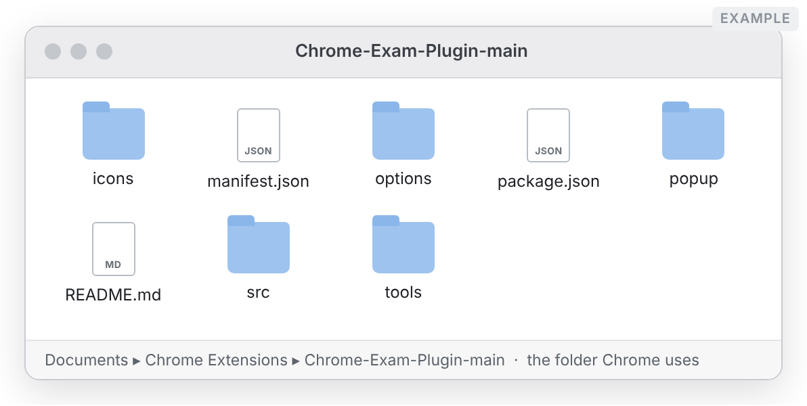
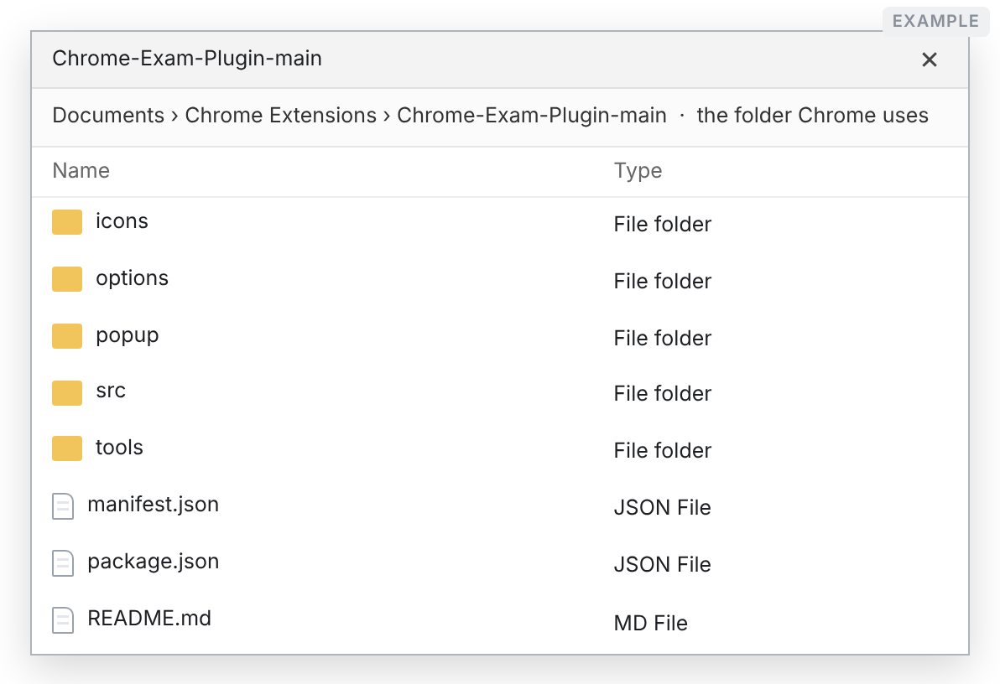
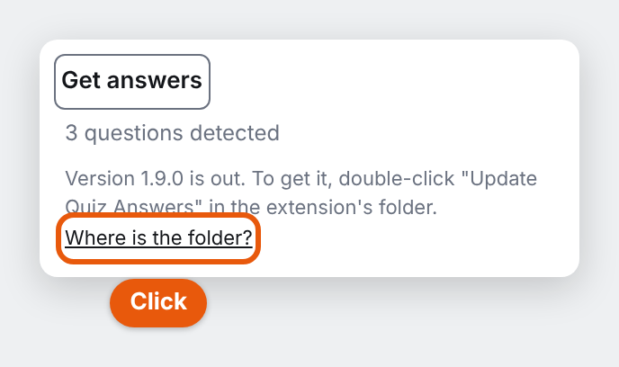

# How to update Quiz Answers

It takes about five minutes. You do not need to install anything, and **your
API key and settings stay exactly as they are**.

Keep this guide open next to Chrome, and do one step at a time. Every step has
a picture of what you will see. Pictures marked **Example** are drawings, and
your screen may look a little different, but the words and buttons are the
same.

<!-- web-only -->
> Prefer paper? Here is the same guide as a PDF you can print or send on:
> [How-to-update-Quiz-Answers.pdf](docs/how-to-update/How-to-update-Quiz-Answers.pdf)
<!-- /web-only -->

---

## First: which version do you have?

1. In Chrome, click the address bar at the top, type `chrome://extensions`
   and press **Enter** (**Return** on a Mac).
2. Find the **Quiz Answers** box. The number next to the name is your version.

**What does yours say?**

- **1.8.0 or higher** → skip to [The easy way](#the-easy-way-version-180-or-higher).
  It is a double-click.
- **Lower than 1.8.0** (for example 1.7.0 or 1.5.1) → do
  [The one-time update](#the-one-time-update-versions-below-180) just below.
  You only ever do this once. After it, you can use the easy way.

---

## The one-time update (versions below 1.8.0)

### Step 1. Open the folder Chrome uses

1. On the Quiz Answers box, click **Details**.

   

2. Scroll down to **Source**. Next to **Loaded from** is the folder's
   location. **Click it.** (On Windows it starts with `~\` instead of `~/`.)

   

3. A folder window opens. This is the extension's folder, and it is the
   only one that matters. **Leave this window open.**

   **On a Mac:**

   

   **On Windows:**

   

### Step 2. Download the new version

1. Open this page: **https://github.com/jincemp/Chrome-Exam-Plugin**
2. Click the green **Code** button, then click **Download ZIP**.

A file called `Chrome-Exam-Plugin-main.zip` goes into your **Downloads**
folder. (If you have downloaded it before, the new one may be called
`Chrome-Exam-Plugin-main (1).zip`. Use the newest one.)

### Step 3. Unzip it

**On a Mac:**

Open your **Downloads** folder and double-click `Chrome-Exam-Plugin-main.zip`.
A folder with the same name appears next to it. **Double-click that folder to
open it.**

**On Windows:**

1. In **Downloads**, right-click `Chrome-Exam-Plugin-main.zip` and choose
   **Properties**. At the bottom, tick **Unblock**, then click **OK**. (No
   Unblock box? Just skip this.)

   

2. Right-click the zip again and choose **Extract All…**, then click
   **Extract**.

   

3. A new folder opens. If you see another folder called
   `Chrome-Exam-Plugin-main` inside it, open that one too. Stop when you can
   see `manifest.json`.

> **Check:** you now have **two** folder windows open: the **old** one from
> Step 1, and this **new** one. Both contain `manifest.json`. The new one is in
> **Downloads**. (If your old folder is in Downloads too, the new one is called
> `Chrome-Exam-Plugin-main 2`.)

### Step 4. Copy the new files into the old folder

**On a Mac:**

1. Click an empty spot inside the **new** folder window. In the menu bar at the very top of
   the screen, click **Edit → Select All**, then **Edit → Copy**.
   (Or press <kbd>⌘</kbd><kbd>A</kbd>, then <kbd>⌘</kbd><kbd>C</kbd>.)

   

2. Click an empty spot inside the **old** folder window, the one from Step 1.
   Click **Edit → Paste**. (Or press <kbd>⌘</kbd><kbd>V</kbd>.)

   

3. A question appears. **Tick "Apply to All"**, then click **Replace**.

   

   > ⚠️ **Never click "Keep Both".** It leaves the old version in place, and
   > nothing gets updated. If you clicked it by mistake, see
   > [Something went wrong?](#something-went-wrong).

**On Windows:**

1. Click an empty spot inside the **new** folder window. Press <kbd>Ctrl</kbd>+<kbd>A</kbd>
   (this selects everything), then <kbd>Ctrl</kbd>+<kbd>C</kbd> (this copies it).

   

2. Click an empty spot inside the **old** folder window, the one from Step 1.
   Press <kbd>Ctrl</kbd>+<kbd>V</kbd>.
3. A question appears. Click **Replace the files in the destination**.

   

### Step 5. Tell Chrome

1. Go back to the `chrome://extensions` tab in Chrome.
2. On the Quiz Answers box, click the **round arrow**.

   

3. The number next to the name changes to the new version: **1.8.0 or
   higher**.

   

✅ **Done!** Your API key and settings are all still there. From now on, use
[the easy way](#the-easy-way-version-180-or-higher) to update. The number
did not change? See [Something went wrong?](#something-went-wrong).

---

## The easy way (version 1.8.0 or higher)

### Step 1. See that there is an update, and open the folder

1. Click the Quiz Answers icon in Chrome's toolbar. When a new version is
   out, the bottom of the box tells you so. Click **Where is the folder?**

   

2. Chrome opens the extension's Details page. Scroll down and click the
   folder path next to **Loaded from**, just as in this picture:

   

   The extension's folder opens.

### Step 2. Double-click the updater

**On a Mac**, double-click **Update Quiz Answers.command**. (The one ending in
`.bat` is for Windows.)

**On Windows**, there are two files with nearly the same name. Double-click
the one whose **Type** says **Windows Batch File**.

### Step 3. The first time only: let it run

Your computer checks with you once, because the file came from the internet.
After that, it just runs.

**On a Mac with macOS 15 (Sequoia) or newer:**

1. A box says the file was **Not Opened**. Click **Done**, never Move to
   Trash.

   

2. Click the Apple menu (the apple at the very top left of the screen), then
   **System Settings**, then **Privacy & Security**. Scroll down to **Security** and
   click **Open Anyway**.

   

3. Click **Open Anyway** once more, then type your Mac password (or use
   Touch ID).

   

   No Open Anyway button? It only stays for about an hour. Double-click the
   file again, click Done, and come straight back here.

**On a Mac with macOS 14 (Sonoma) or older:** right-click (or Control-click)
the file, choose **Open**, then click **Open** again.

**On any Mac:** if you are asked whether "Terminal" may access a folder, click
**Allow**.

**On Windows**, you may see one of these. Click the button shown.

Does it say the file was **blocked**, with no button to run it? Close that
message. Right-click **Update Quiz Answers**, choose **Properties**, tick
**Unblock** at the bottom, click **OK**, and double-click it again.

### Step 4. Let it finish

A window shows the progress. It takes a few seconds. When it says
**"Updated Quiz Answers from … to …"**, press **Return** (Mac) or **Enter**
(Windows) to close it.

**On a Mac:**

**On Windows:**

### Step 5. Finish in Chrome

Click the Quiz Answers icon. If the button says **Restart to finish the
update**, click it. Then click the icon again.

✅ **Done!** (Is the button just **Get answers**? Then it has already
switched over by itself, and there is nothing more to do.)

---

## Something went wrong?

**The version number did not change after the one-time update.**
The new files went into a different folder. Go back to
[Step 1](#step-1-open-the-folder-chrome-uses) and use the window that opens
when you click **Loaded from**. That is the folder to paste into.

**The Quiz Answers box has an "Errors" button, saying "Service worker
registration failed", and Get answers does nothing.** Chrome restarted it
while the new files were still being copied. Make sure the copying has
finished (no progress bar, no question waiting in another window), then click
the **round arrow** on the box. Then click **Errors** and **Clear all**. Old
messages stay in that list even after the problem is fixed.

**I clicked "Keep Both" by mistake.** Nothing is broken. Do
[Step 4](#step-4-copy-the-new-files-into-the-old-folder) again, and this time
click **Replace**. Afterwards you may see extra items ending in "copy" or
"2" in the old folder. You can leave them.

**Chrome now shows two Quiz Answers boxes.** Click **Details** on each. Keep
the one whose **Loaded from** is the folder you updated. Switch the other one
off with the switch at its bottom right.

**It is asking for my API key again.** Chrome is loading a different folder
than before. That happens if the folder was moved or renamed. Paste your key
in again, and everything else carries on as normal.

**Mac: "could not be executed because you do not have appropriate access
privileges".** Open **Terminal** (press <kbd>⌘</kbd>+<kbd>Space</kbd>, type
*Terminal*, press Return). Type `bash` and a space, drag **Update Quiz
Answers.command** into the Terminal window, and press Return. After one run
like this, double-clicking works again.

**Mac: "Operation not permitted".** Open the Apple menu → **System
Settings** → **Privacy & Security** → **Files & Folders** → **Terminal**, and
switch on the folder Quiz Answers is in (Documents, Desktop or Downloads).
Then double-click the updater again.

**Windows: the window flashes and closes, or says scripts are disabled or
"restricted".** That PC does not allow scripts. Use
[the one-time update](#the-one-time-update-versions-below-180) steps instead.
They work for every version.

**Quiz Answers stopped working, and its box says "Turn on developer mode".**
At the top right of `chrome://extensions`, switch **Developer mode** on. It
needs to stay on.

---

**Good to know**

- Your API key is kept inside Chrome, not in the folder, so updating never
  touches it.
- Never move or rename the extension's folder. Chrome finds Quiz Answers by
  where that folder is.
- Keep **Developer mode** switched on at `chrome://extensions`.
