# How to update Quiz Answers

Once it is set up, updating Quiz Answers is one click. Getting there takes a few
minutes, once. You do not need to install anything, and **your API key stays
exactly as it is**, so you will not have to set anything up again.

Keep this guide open next to Chrome, and do one step at a time. Every step has
a picture of what you will see. Pictures marked **Example** are drawings: your
screen may look a little different, but the buttons you need to click have the
same names. The orange rings and labels show you where to click. They are not
on your screen.

<!-- web-only -->
> Prefer paper? Here is the same guide as a PDF you can print or send on:
> [How-to-update-Quiz-Answers.pdf](docs/how-to-update/How-to-update-Quiz-Answers.pdf)
<!-- /web-only -->

---

## First: which version do you have?

1. In Chrome, click the address bar at the top, type `chrome://extensions`
   and press **Enter** (**Return** on a Mac).
2. Find the **Quiz Answers** box. The number next to the name is your version.
   (No number? Switch **Developer mode** on at the top right first. It needs
   to stay on.)

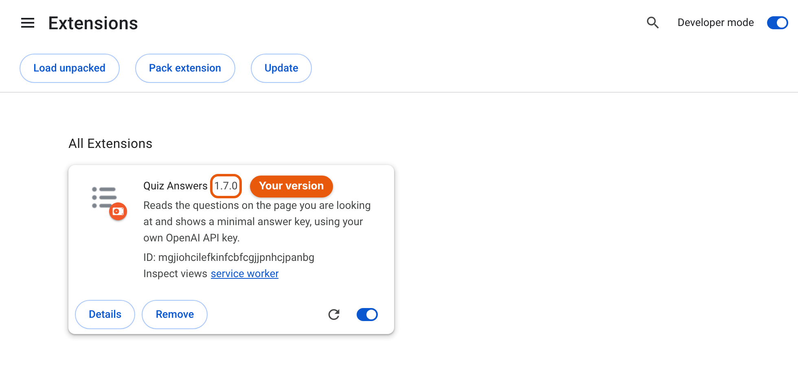

**What does yours say?**

- **1.9.0 or higher** → go to
  [C. Every update after that: one click](#c-every-update-after-that-one-click).
- **1.8.0 or 1.8.1** → go to
  [B. Switch on the Update button](#b-switch-on-the-update-button-once). It is
  one file, double-clicked twice.
- **Lower than 1.8.0** (for example 1.7.0 or 1.5.1) → start with
  [A. The one-time update](#a-the-one-time-update-versions-below-180) just
  below, then do B.

You only ever do A and B once. After that, it is always C.

---

## A. The one-time update (versions below 1.8.0)

This one time, you copy the new version into the folder Chrome uses by hand.

### Step 1. Find the folder Chrome uses

You are still on `chrome://extensions`.

1. On the Quiz Answers box, click **Details**. (Never **Remove**: that deletes
   your API key.)

   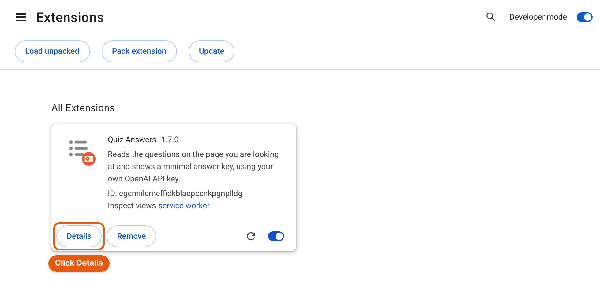

2. Scroll down to **Source**. Next to **Loaded from** is the location of the
   folder Chrome uses. You will click it in Step 4. **Leave this page open.**

### Step 2. Download the new version

1. Open a **new tab**: click the **+** next to your tabs, at the top of Chrome.
   (The Details page stays open in its own tab.)
2. In the new tab, open this page: **https://github.com/jincemp/Chrome-Exam-Plugin**
3. Click the green **Code** button, then click **Download ZIP**.

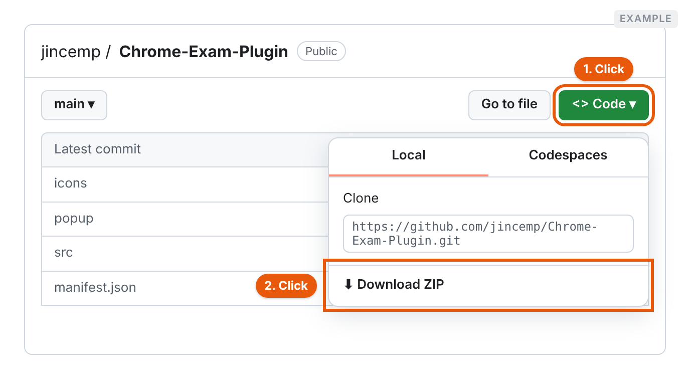

A file called `Chrome-Exam-Plugin-main.zip` goes into your **Downloads**
folder. If you have downloaded it before, the new one may be called
`Chrome-Exam-Plugin-main (1).zip`: always use the one with the highest number.

### Step 3. Unzip it, and copy everything in it

**On a Mac:**

1. Click the Finder icon in the Dock (the blue and white face at the bottom of
   the screen). In the window that opens, click **Downloads** on the left.
2. Double-click the zip you just downloaded. A new folder appears next to it,
   called `Chrome-Exam-Plugin-main`. (If a folder with that name was there
   already, the new one is called `Chrome-Exam-Plugin-main 2`.)
   **Double-click the new folder to open it.**

   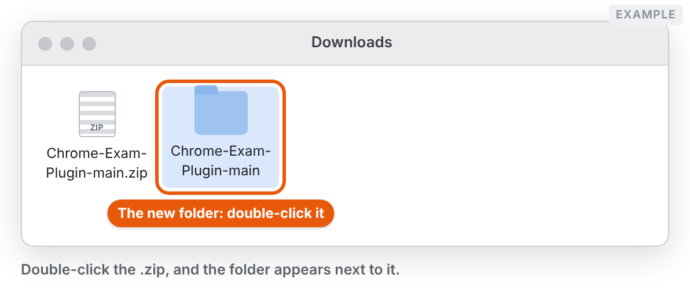

   (Downloaded with Safari instead of Chrome? Safari unzips by itself, so
   there is no zip, just the folder. Open that folder.)

3. **Check:** the new folder has a file called **Update Quiz Answers.command**
   in it. Not there? You opened an old download. Go back to Step 2.

   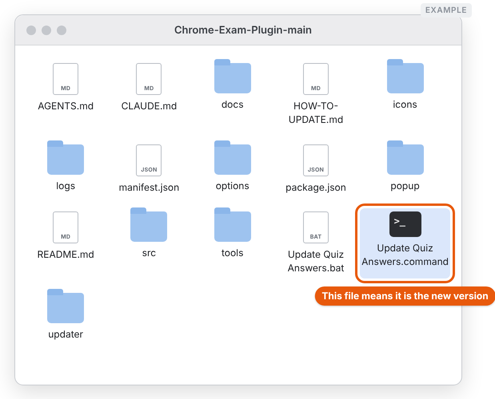

4. Click an empty spot in the folder window. In the menu bar at the very top
   of the screen, click **Edit → Select All**, then **Edit → Copy**.
   (Or press <kbd>⌘</kbd><kbd>A</kbd>, then <kbd>⌘</kbd><kbd>C</kbd>.)

   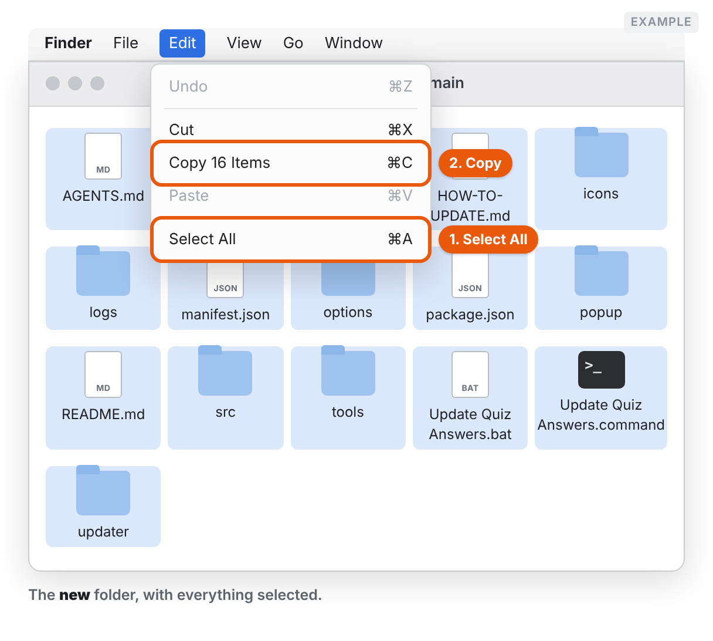

**On Windows:**

1. Open File Explorer: hold down the Windows key and press <kbd>E</kbd>. Click
   **Downloads** on the left.
2. Right-click the zip you just downloaded and choose **Properties**. (Windows
   may hide the `.zip` at the end of the name: it is the one with a zipper on
   its icon.) At the bottom, tick **Unblock**, then click **OK**. (No Unblock
   box? Just skip this.)

   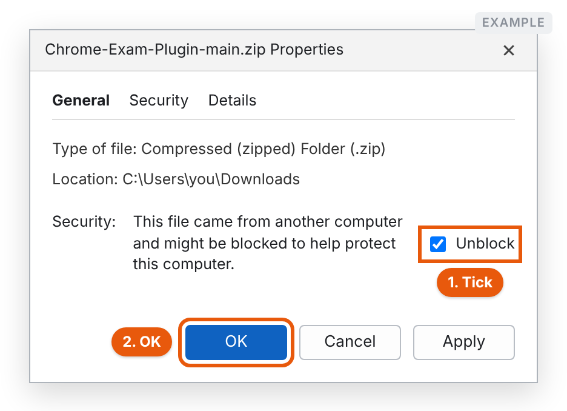

3. Right-click the zip again and choose **Extract All…**, then click
   **Extract**. (If a box asks whether to replace or skip files, click
   **Replace the files in the destination**.)

   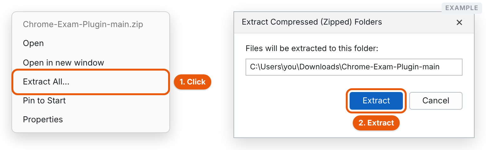

4. A new folder opens. If you see another folder called
   `Chrome-Exam-Plugin-main` inside it, open that one too.
   **Check:** you can see **Update Quiz Answers** in it. Not there? You opened
   an old download. Go back to Step 2.

   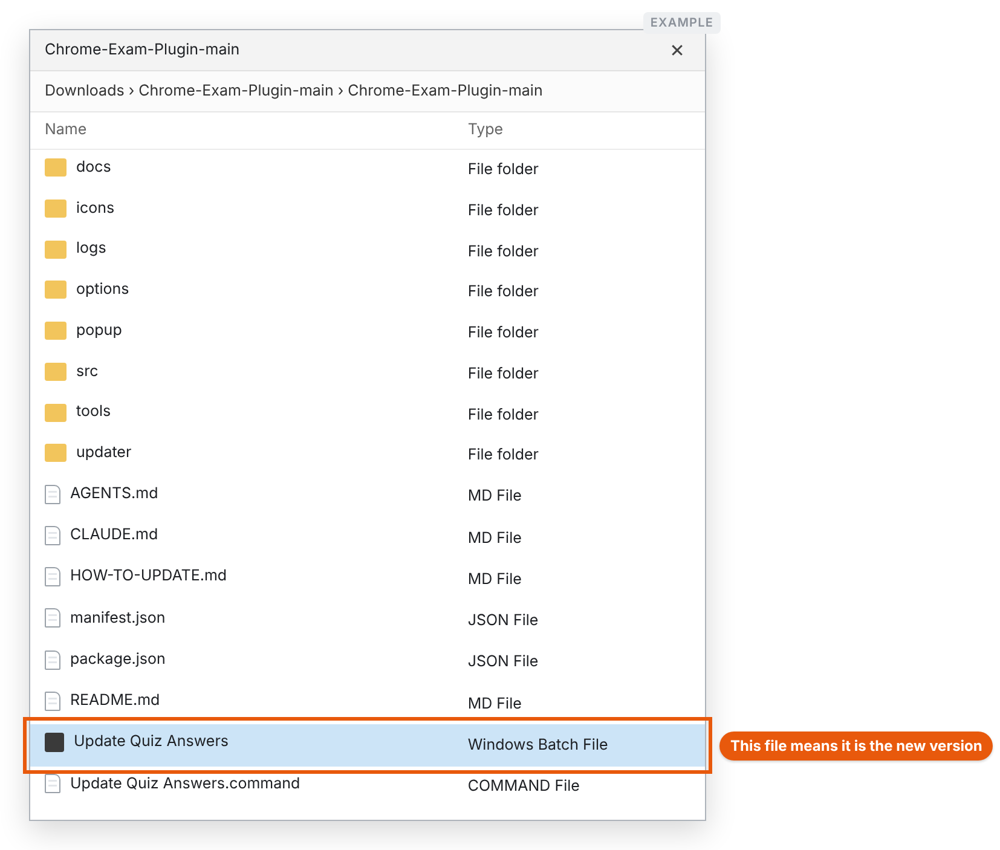

5. Click an empty white space below the files (not in the column on the
   left). Hold down <kbd>Ctrl</kbd> and press <kbd>A</kbd>: everything turns
   blue. Then hold down <kbd>Ctrl</kbd> and press <kbd>C</kbd>.

   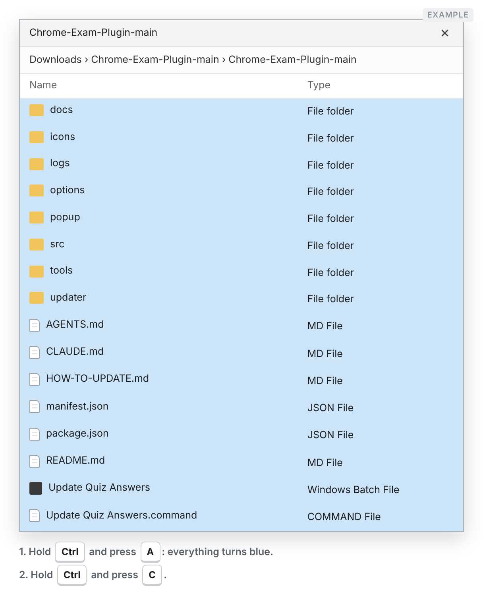

### Step 4. Paste them into the folder Chrome uses

1. Go back to Chrome and click the tab with the Details page. Click the
   folder location next to **Loaded from**. (On Windows it starts with `~\`
   instead of `~/`.)

   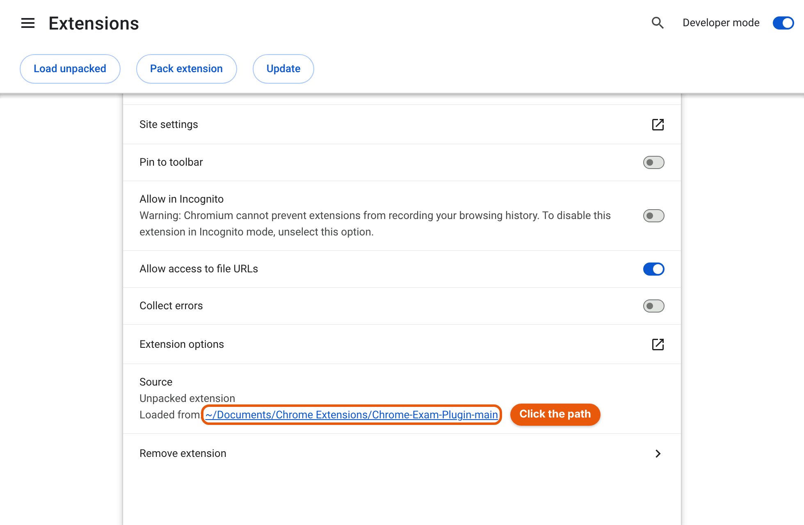

2. A folder window opens. **This is the folder Chrome uses.** (Was your
   version below 1.8.0, and this folder already has **Update Quiz Answers** in
   it? Then the new files are already in. Do not paste: skip to Step 5.)

**On a Mac:**

3. Click an empty spot in that folder window. Click **Edit → Paste**. (Or
   press <kbd>⌘</kbd><kbd>V</kbd>.)

   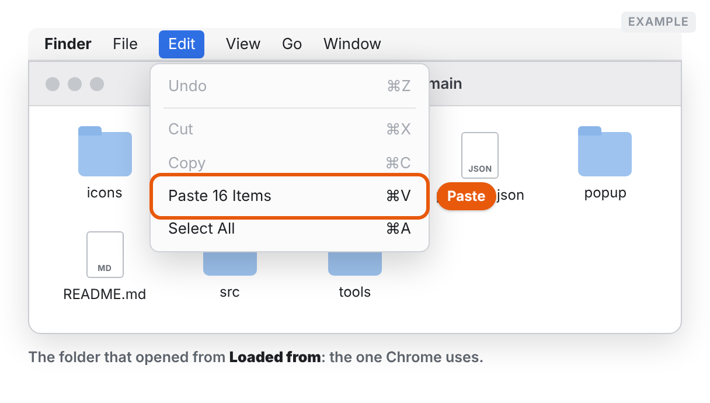

4. A question appears. **Tick "Apply to All"**, then click **Replace**.

   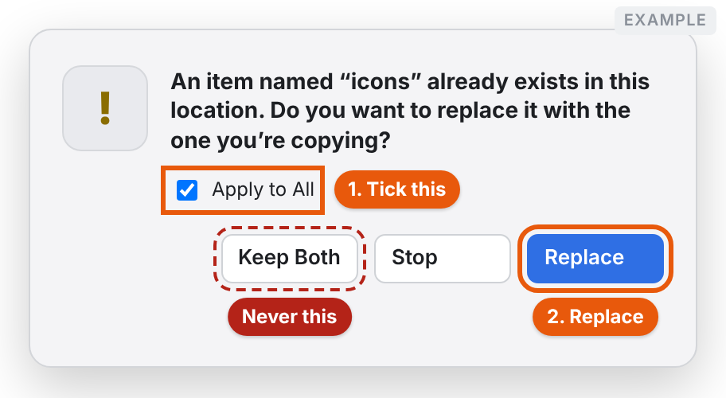

   > ⚠️ **Never click "Keep Both".** It leaves the old version in place.

**On Windows:**

3. Click an empty white space in that folder window. Hold down
   <kbd>Ctrl</kbd> and press <kbd>V</kbd>.

   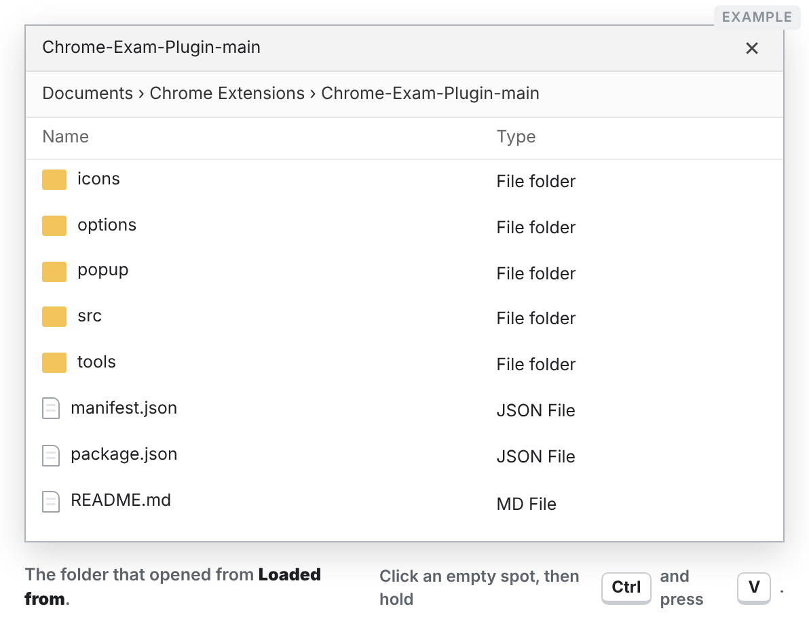

4. A question appears. Click **Replace the files in the destination**.

   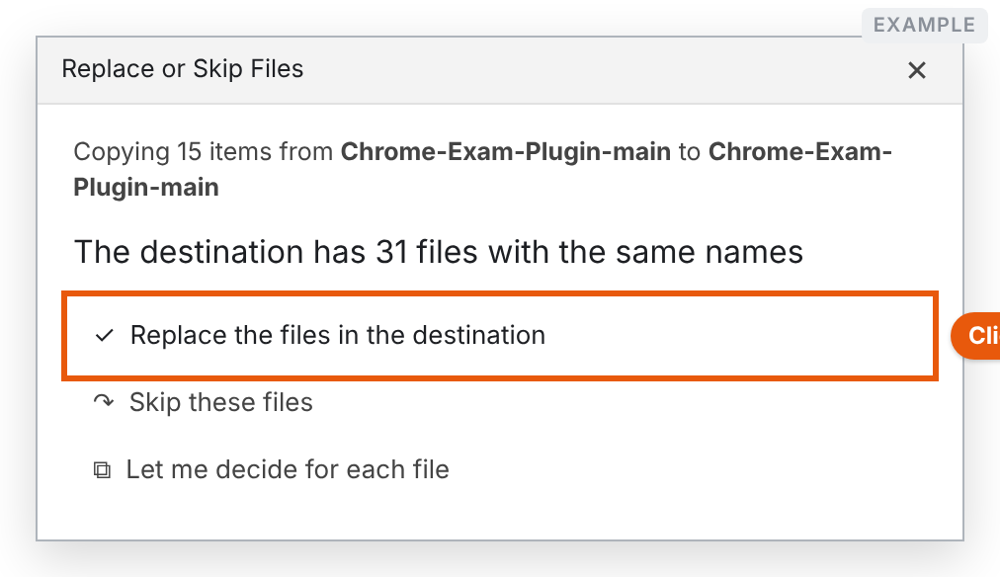

   > ⚠️ **Never click "Skip these files".** It leaves the old version in place.

No question appeared? Then the files went into a different folder. That does
no harm: click the location next to **Loaded from** again, and paste into the
window that opens.

### Step 5. Tell Chrome

1. In Chrome, click the address bar, type `chrome://extensions` and press
   **Enter** (**Return** on a Mac), just as at the start.
2. On the Quiz Answers box, click its **round arrow**. (Not Chrome's own round
   arrow, next to the address bar.)

   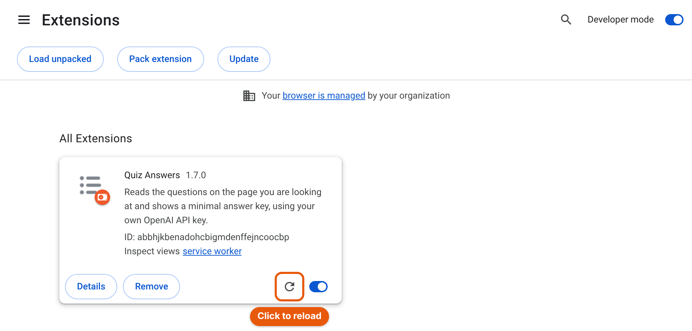

3. The number next to the name changes to the new version: **1.9.0 or
   higher**.

   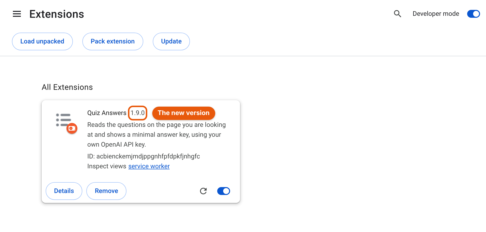

✅ **The new version is in**, and your API key is still there. You can delete
the zip. Leave every folder where it is: the folder you unzipped can have the
same name as the one Chrome uses, or even be it. The number did not change? See
[Something went wrong?](#something-went-wrong)

**One more thing, once:** do
[B. Switch on the Update button](#b-switch-on-the-update-button-once) now.
Then you never have to copy files again.

---

## B. Switch on the Update button (once)

Do this if you have version 1.8.0 or 1.8.1, or straight after A. You
double-click one file: once after A, twice if you have 1.8.0 or 1.8.1 (Step 4
says when). It also installs the newest version, if you do not have it yet.
Afterwards, Quiz Answers has an **Update now** button.

### Step 1. Open the folder Chrome uses

1. In Chrome, click the address bar, type `chrome://extensions` and press
   **Enter** (**Return** on a Mac).
2. On the Quiz Answers box, click **Details** (never **Remove**). Scroll down
   to **Source**, and click the folder location next to **Loaded from**.

   

   The folder Chrome uses opens.

### Step 2. Double-click the updater

**On a Mac**, double-click **Update Quiz Answers.command**. (The one ending in
`.bat` is for Windows.)

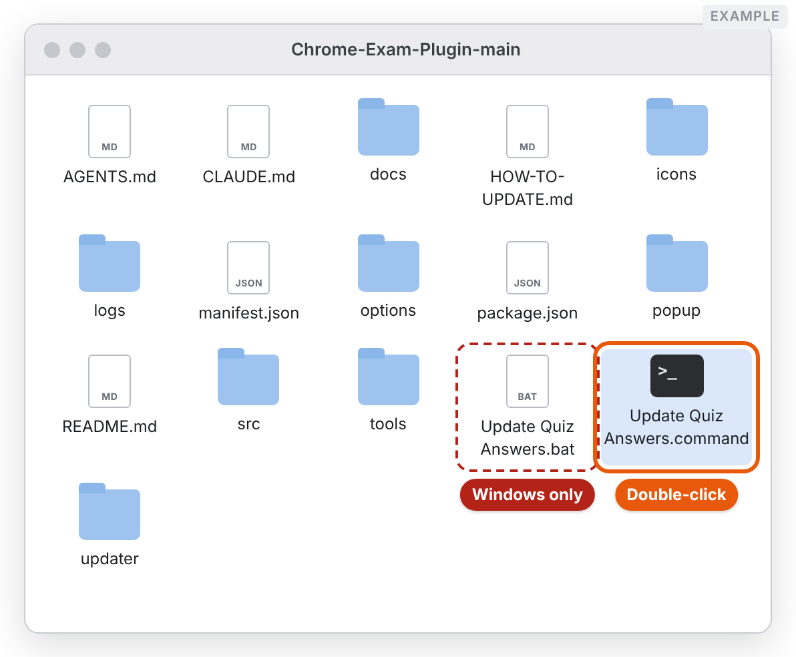

**On Windows**, there are two files with nearly the same name. Double-click
the one whose **Type** says **Windows Batch File**.

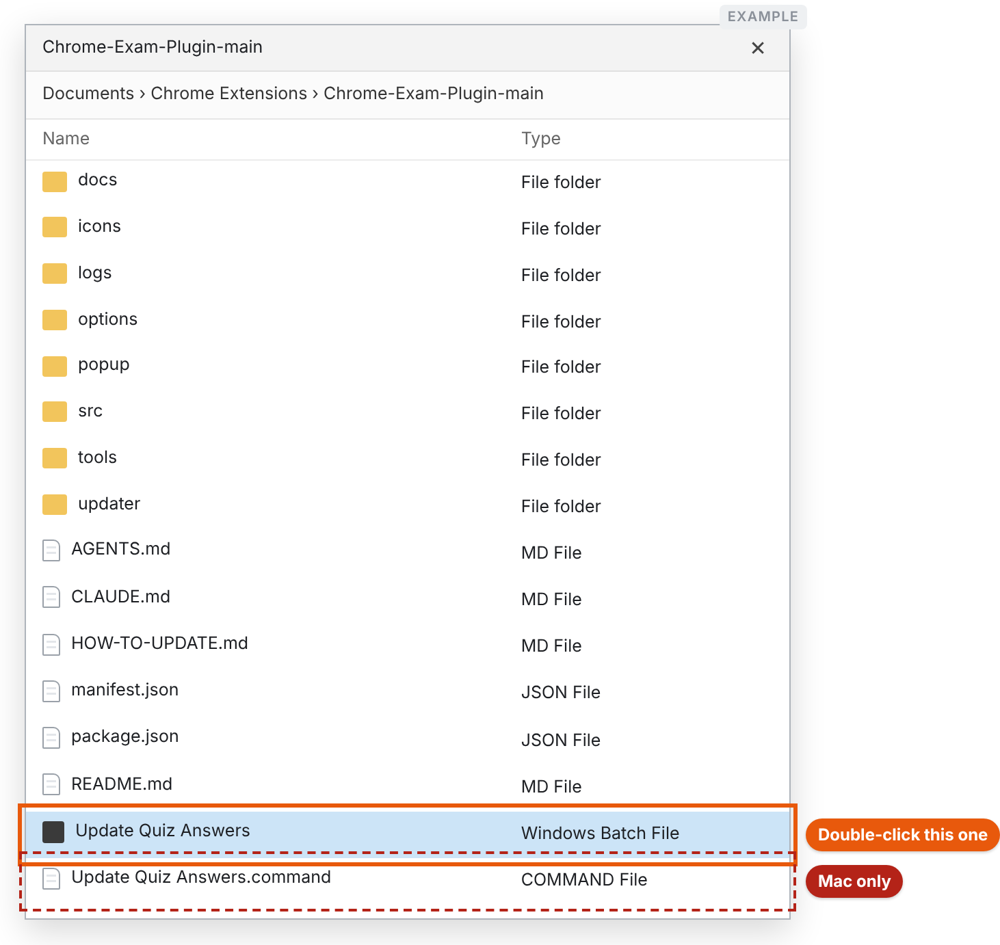

### Step 3. The first time only: let it run

Your computer checks with you once, because the file came from the internet.
After that, it just runs.

**On a Mac**, a box appears. **Never click "Move to Trash".** Look at the box:

- **It says "Not Opened" and has a Done button** (macOS 15 or newer): do 1 to
  3 below.
- **It has no Done button** (macOS 14 or older): click **OK** or **Cancel**.
  Then right-click (or Control-click) the file, choose **Open**, and click
  **Open** again. Then skip 1 to 3 below, read **On any Mac** just after
  them, and go on to Step 4.

1. Click **Done**.

   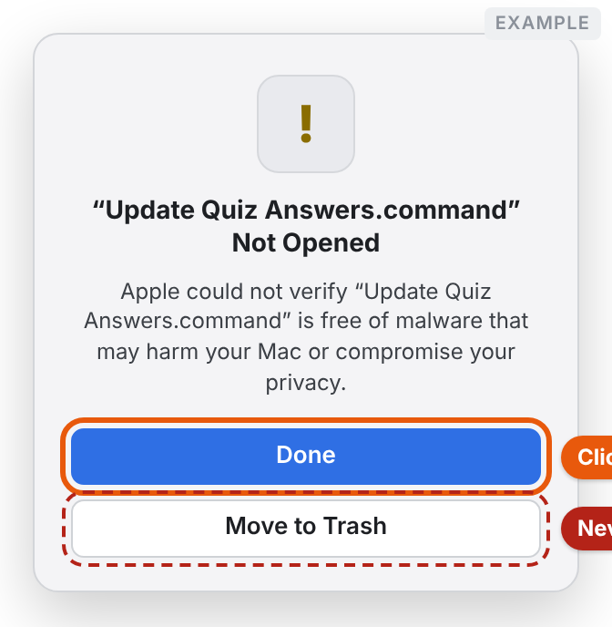

2. Click the Apple menu (the apple at the very top left of the screen), then
   **System Settings**, then **Privacy & Security**. Scroll down to
   **Security**, and click **Open Anyway**.

   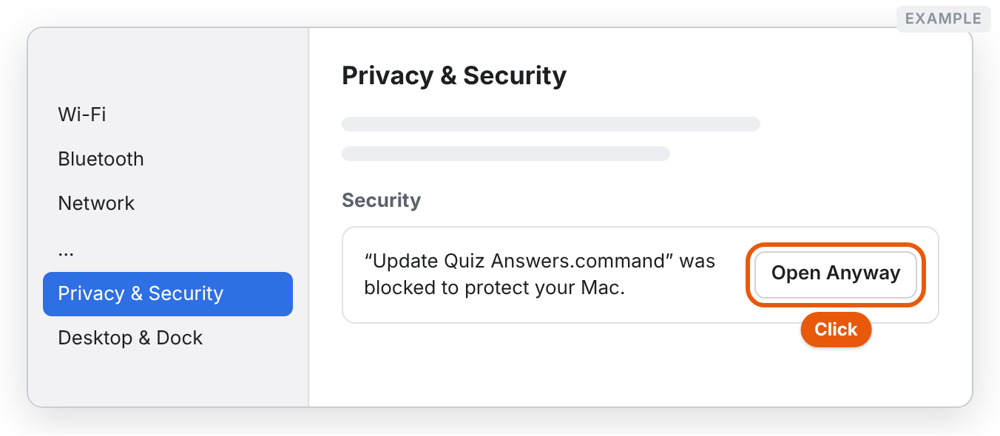

3. Click **Open Anyway** once more, then type your Mac password (or use Touch
   ID). If your Mac account is not an administrator, someone who is has to type
   their password here.

   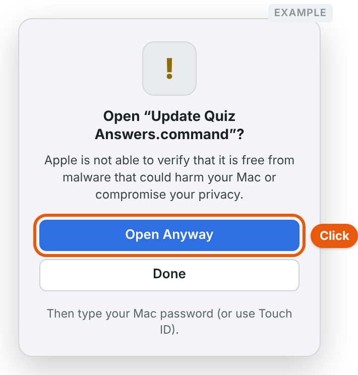

   No Open Anyway button? It only stays for about an hour. Double-click the
   file again, click **Done**, and come straight back here. Still no button,
   or your password is not accepted? Use
   [the Terminal way](#mac-it-will-not-open).

**On any Mac:** if a box asks whether **"Terminal"** may access files in a
folder, click **Allow** (on some Macs it says **OK**). Never "Don't Allow".

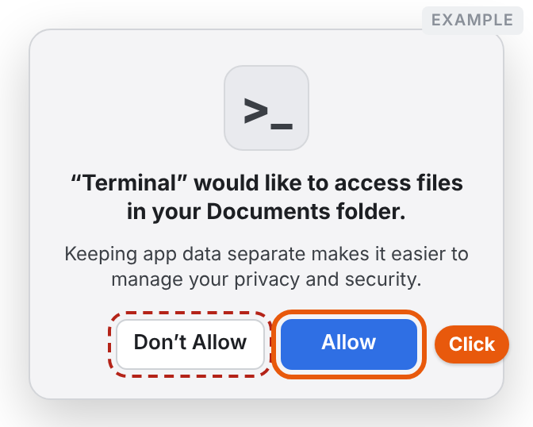

**On Windows**, you may see one of these. Click the button shown.

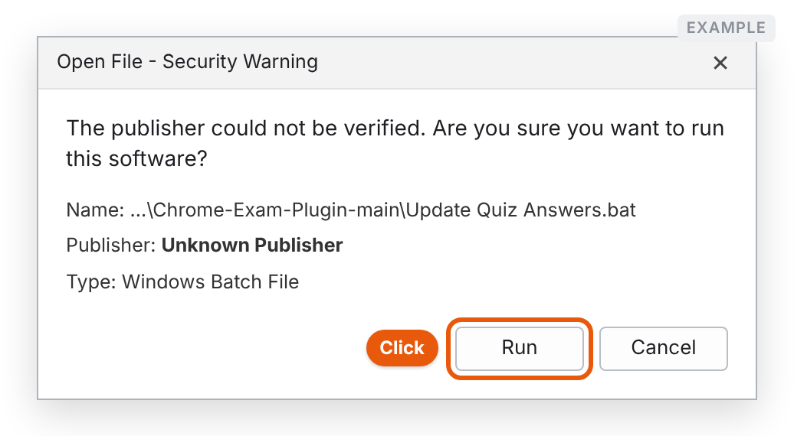

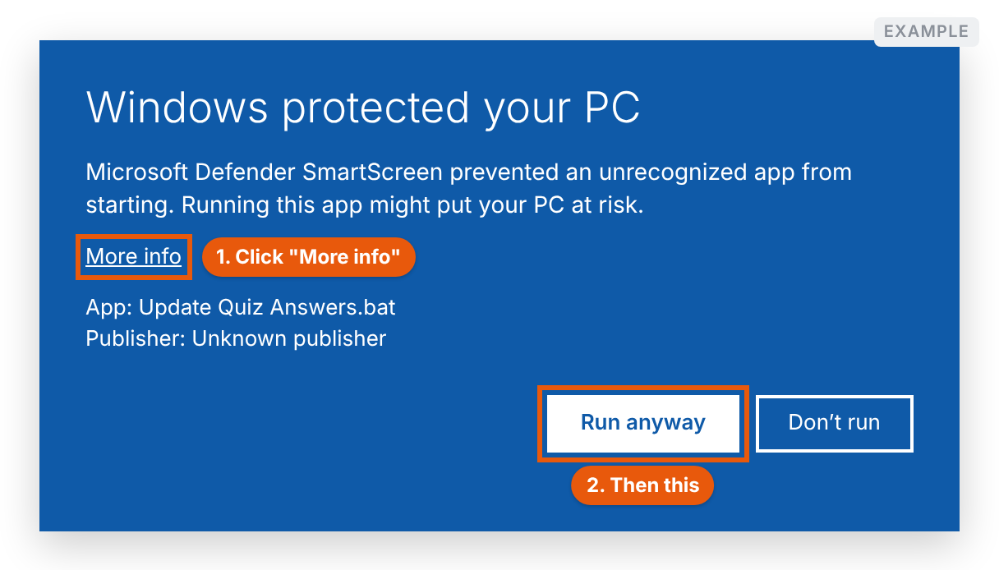

Does it say the file was **blocked**, with no button to run it? Close that
message. Right-click **Update Quiz Answers**, choose **Properties**, tick
**Unblock** at the bottom, click **OK**, and double-click it again.

### Step 4. Let it finish

A window shows the progress. It takes a few seconds. When it says **"From now
on Quiz Answers can update itself"**, press **Return** (Mac) or **Enter**
(Windows).

**Had 1.8.0 or 1.8.1?** Then this first time the window ends with **"Updated
Quiz Answers from 1.8.… to …"** and no "From now on…" line. That is expected:
your old version did this part, and it cannot switch the button on. Press
**Return** (Mac) or **Enter** (Windows), close the window, and double-click
**Update Quiz Answers** once more, exactly as in Step 2. This time it says
**"You already have the latest version"** and **"From now on Quiz Answers can
update itself"**.

On a Mac, the window may then stay open and say **[Process completed]**. That
is fine: close it with the red dot at its top left.

**On a Mac:**

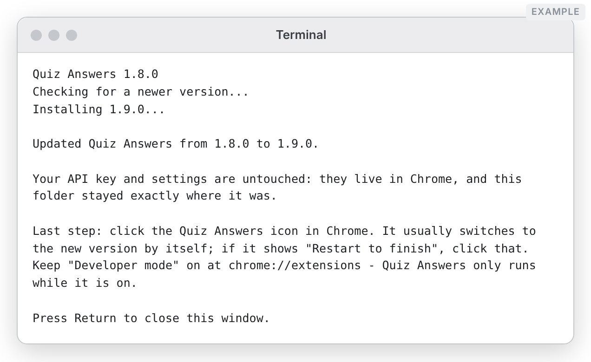

**On Windows:**

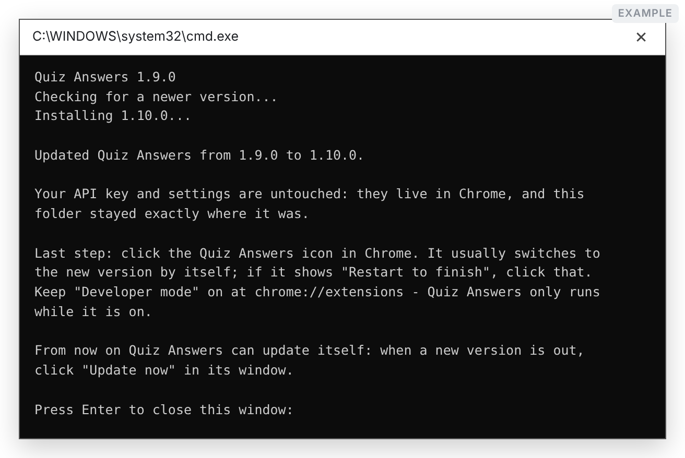

It says **"You already have the latest version"** instead of "Updated"? That
is right if you have just done A, or if this is your second double-click. It
still switches the button on.

### Step 5. Finish in Chrome

1. Go back to Chrome and click a tab with an ordinary website in it, such as
   your quiz. (Not the Extensions tab: there, Quiz Answers can only say
   "Cannot read this page".)
2. Click the Quiz Answers icon. If the button says **Restart to finish the
   update**, click it. Then click the icon again.

   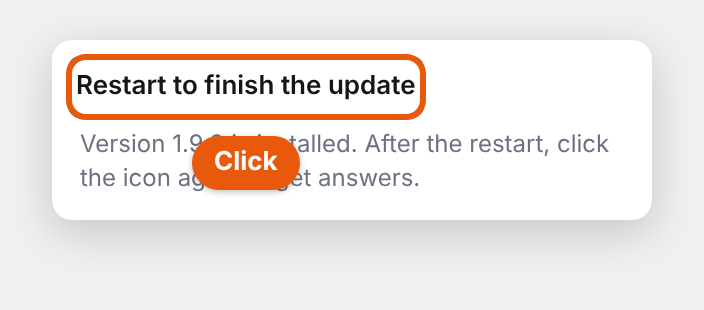

✅ **Done!** From now on, use [C](#c-every-update-after-that-one-click) to
update.

No Restart button? Then there is nothing more to do. Does the bottom of the box
say the new version **switches over by itself once you close or leave the page
with answers**? Then you are done too: it finishes by itself when you close
that page, so leave **Restart now (clears answers)** alone.

---

## C. Every update after that: one click

### Step 1. Click "Update now"

Click a tab with an ordinary website in it, then click the Quiz Answers icon.
When a new version is out, the bottom of the box says so. Click **Update now**.

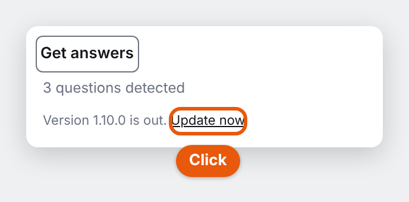

- **No line about a new version?** Then you already have the newest one. (It
  checks about once an hour. To check right now, right-click the Quiz Answers
  icon and choose **Options**: the settings page asks straight away, and has
  the same **Update now** button. If you update from there, click **Restart
  now** on that page when it appears.)
- **It says to double-click "Update Quiz Answers" instead?** The button is not
  switched on yet: do
  [B. Switch on the Update button](#b-switch-on-the-update-button-once) once.
  (It says updating from here is switched off on this computer, or it still
  says to double-click after you have done B? Then the button cannot work on
  this computer: do B each time there is a new version.)

### Step 2. Let it update

**On Windows**, the box says **Updating to …** for a few seconds, then
**Restarting…**, and closes by itself.

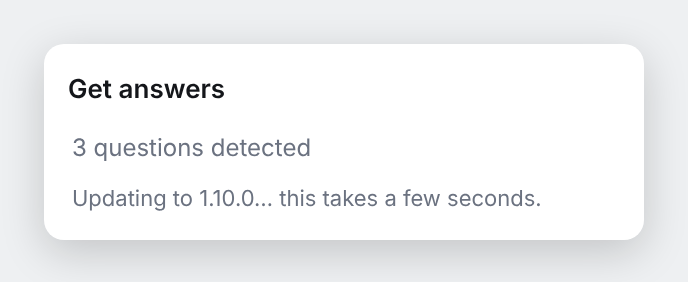

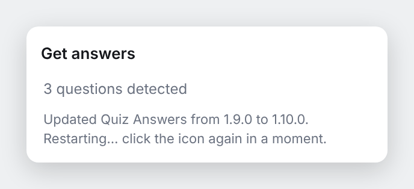

**On a Mac**, a Terminal window opens and does the update, just as in B. Leave
it open until it has finished: it says **"Updated Quiz Answers from … to …"**,
or why it did not work. Then press **Return**, and close the window with the
red dot at its top left. (If a box asks whether
**"Terminal"** may access files in a folder, click **Allow**.)

### Step 3. Click the icon again

Click the Quiz Answers icon again. ✅ **Done!** It has usually switched to the
new version by itself. If the button says **Restart to finish the update**,
click it, then click the icon again.

Does the bottom of the box say the new version **switches over by itself once
you close or leave the page with answers**? Then you are done too: it finishes
by itself when you close that page.

Did it say the update did not work? It says why. You can always update with
the double-click instead: do
[B. Switch on the Update button](#b-switch-on-the-update-button-once) again.

---

## Something went wrong?

**The version number did not change after the one-time update.**
First check that you clicked the round arrow on the Quiz Answers box itself,
not Chrome's own one next to the address bar. Still the old number? The new
files went into a different folder, or you unzipped an old download. Do
**every** step of [A](#a-the-one-time-update-versions-below-180) again, with a
fresh download, and paste into the window that opens from **Loaded from**,
even if **Update Quiz Answers** is already in it.

**I clicked "Keep Both" (Mac) or "Skip these files" (Windows) by mistake.**
Nothing is broken. Do
[Step 4](#step-4-paste-them-into-the-folder-chrome-uses) of A again. Paste even
though **Update Quiz Answers** is in the folder now, and this time click
**Replace**. You may see extra items ending in "2" in the folder afterwards.
You can leave them.

**The Quiz Answers box has an "Errors" button, saying "Service worker
registration failed", and Get answers does nothing.** Chrome restarted it
while the new files were still being copied. Make sure the copying has
finished (no progress bar, no question waiting in another window), then click
the **round arrow** on the box. Then click **Errors** and **Clear all**. Old
messages stay in that list even after the problem is fixed.

**There are two Quiz Answers boxes.** Click **Details** on each. Keep the one
whose **Loaded from** is the folder you updated, and switch the other one off
with the switch at its bottom right. (Not updated yet? Click the Quiz Answers
icon: the copy that gives answers without asking for a key is the one to
update.)

**It is asking for my API key again.** Chrome is using a different copy of Quiz
Answers: the folder was moved or renamed, or Quiz Answers was removed and added
again. Paste your key in again (click the Quiz Answers icon, then **Open
settings**). No copy of it? Make a new key at
https://platform.openai.com/api-keys, the same way as when you first set it up.

**Quiz Answers has disappeared from `chrome://extensions`.** It was removed,
and its saved key went with it. Click **Load unpacked** at the top left (with
**Developer mode** on), choose the same folder as before, and paste your API key
in again.

**Mac: I clicked "Move to Trash".** Open the Trash (the bin at the end of the
Dock). Right-click **Update Quiz Answers.command** and choose **Put Back**.
Then start again at [Step 2 of B](#step-2-double-click-the-updater).

**Mac: it will not open (no Open Anyway button, your password is not
accepted, or "could not be executed because you do not have appropriate access
privileges").** Open **Terminal**: press <kbd>⌘</kbd>+<kbd>Space</kbd>, type
*Terminal*, and press Return. Type `bash` and a space (type it yourself; do not
paste it). Drag **Update Quiz Answers.command** from its folder into the
Terminal window, and press Return. It runs exactly as a double-click would,
without the "Not Opened" box. (If a box asks whether "Terminal" may access
files in a folder, click **Allow**.) When it has finished, press Return, then
close the window with the red dot at its top left.

**Mac: "macOS did not let Terminal open the Quiz Answers folder", or
"Operation not permitted".** Open the Apple menu → **System Settings** →
**Privacy & Security** → **Files & Folders**. Under **Terminal**, switch on the
folder Quiz Answers is in: **Documents**, **Desktop** or **Downloads**. Then
double-click **Update Quiz Answers** again (or click **Update now**).

**Windows: the window flashes and closes, or says scripts are disabled or
"restricted".** That PC does not allow scripts, so neither the double-click
nor the Update now button can work on it. Use the steps in
[A. The one-time update](#a-the-one-time-update-versions-below-180) for every
update instead. They work for every version. In Step 4, always paste, even
though **Update Quiz Answers** is already in the folder.

**Quiz Answers stopped working, and its box says "Turn on developer mode".**
At the top right of `chrome://extensions`, switch **Developer mode** on. It
needs to stay on. If Chrome offers **Remove** or **Remove all**, do not click
it: that deletes Quiz Answers and your saved API key.

---

**Good to know**

- Your API key is kept inside Chrome, not in the folder, so updating never
  touches it.
- Never click **Remove** on Quiz Answers. That deletes your API key and
  settings.
- Never move, rename or delete the extension's folder. Chrome finds Quiz
  Answers by where that folder is.
- Keep **Developer mode** switched on at `chrome://extensions`.
